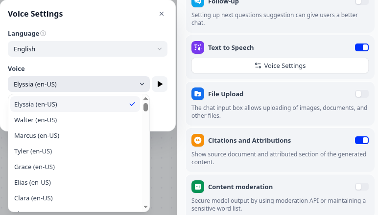

# Lazybird for Dify

Give your Dify apps a realistic voice. This model plugin adds [Lazybird](https://lazybird.app) as a text to speech provider: 500+ AI voices in 150+ languages and accents, plus any voice you cloned or designed in Lazybird.

Lazybird is an AI voiceover generator with a [text to speech API](https://lazybird.app/text-to-speech-api). The free plan includes 10,000 credits a month, no credit card needed.

**Author:** Lazybird · **Contact:** support@lazybird.app · **Source:** https://github.com/lazybirdai/dify-plugin-lazybird

## Setup

1. [Sign up for Lazybird](https://lazybird.app) and create an API key in [Studio settings](https://lazybird.app/studio/settings).
2. In Dify, install **Lazybird** from the Dify Marketplace.
3. Open **Integrations → Model Provider** (**Settings → Model Provider** in older versions), find **Lazybird** and click **Add API Key**. Paste your key and save. Dify checks the key against your Lazybird account.
4. Click **Default Models** (**System Model Settings** in older versions) and choose **Lazybird TTS** as the **Text-to-Speech Model**.

## Usage

**Read answers aloud.** In a Chatbot, Chatflow or Agent app, open **Features**, turn on **Text to Speech**, then open **Voice Settings** to pick a language and a voice. Visitors get a play button on each answer, and you can turn on **Auto Play**.

**Choosing a voice.** The voice list shows your own Lazybird voices first, then the Lazybird library. Set a language in the Text to Speech settings to see only the voices for that language. Every voice in the list works with the model, including your cloned and designed voices.

**Long answers.** Long text is split at sentence ends into chunks of up to 2,000 characters, and the audio streams chunk by chunk, so playback starts before the whole answer is spoken.

**Credits.** One credit is one character of text, shared between the Lazybird studio and the API. Paid plans start at $9 a month; see [pricing](https://lazybird.app/pricing).

## Connection requirements

- The plugin calls the Lazybird API at `https://api.lazybird.app` over HTTPS. Self-hosted Dify needs outbound access to that host.
- The API key is the only credential. It is sent as the `X-API-Key` header and stored in Dify's encrypted credential store.
- Errors carry Lazybird's own message, for example an invalid API key, an unknown voice or no credits left.

## Privacy

The plugin sends the text and the chosen voice to Lazybird to generate the audio, and stores nothing itself. See [PRIVACY.md](PRIVACY.md).

## Support

Open an issue at https://github.com/lazybirdai/dify-plugin-lazybird/issues or write to support@lazybird.app.

## License

MIT
